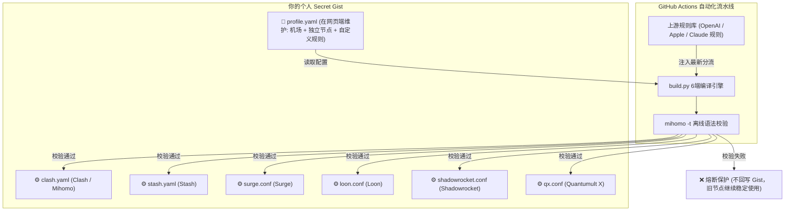

# Claude Sub Hub

> 🚀 **全平台全协议多机场与 Claude 独立出口自动化同步系统**
>
> 节点与规则深度解耦：自主管理 1~4 家机场及 Claude 独立出口，全自动继承上游最新的精准分流规则，一键编译并发布至单个 Secret Gist，全平台免密秒级消费。

---

## ✨ 核心特性

- **6 大主流客户端全适配**：
  - **Clash / Mihomo** (`clash.yaml`) - 桌面端与 Android 标配
  - **Stash** (`stash.yaml`) - iOS / macOS 平台规则优化版
  - **Surge** (`surge.conf`) - iOS / macOS 专业级规则与 Underlying-Proxy 链式代理
  - **Loon** (`loon.conf`) - iOS 现代轻量级代理与 Remote Rule
  - **Shadowrocket** (`shadowrocket.conf`) - iOS 小火箭一键订阅
  - **Quantumult X** (`qx.conf`) - iOS 经典神机代理与 Filter Remote
- **Claude 出口物理隔离与代理链控制**：
  - Claude / Anthropic 专用节点（波特兰 VPS、独立住宅 IP、专线订阅）物理隔离于常规中转池。
  - 支持 **`use_relay_chain: true / false`** 全局开关及单节点自主覆盖（经由中转链式前置拨号 vs 直接直连拨号）。
- **三层分流规则自由定制**：
  - 默认继承上游全部成熟分流（OpenAI、Claude、Apple、Telegram、Steam、国内外 AI、邮件、直连等）。
  - 支持在 `profile.yaml` 中追加 **直连 (Direct)**、**中转 (Relay)**、**海外出口 (Claude Exit)** 自定义规则，支持远端规则集 URL 或本地单条规则，优先置顶匹配。
- **1~4+ 家多机场与自建节点混部**：自动按机场前缀防重名，并自动组装「单机场择优组」、「跨机场全局择优组」、「故障转移 Fallback 组」与「区域聚合组（港/日/美/新/台）」。
- **单 Gist 双向闭环**：输入（`profile.yaml`）与全端输出汇聚在同一个 GitHub Secret Gist。手机浏览器即可改节点，零 Git 冲突风险。
- **离线内核校验与熔断保护**：集成 `mihomo -t` 内核离线语法检验。格式写错时自动熔断并保留旧配置，绝不污染云端 Gist，网络绝不断网。

---

## 🏗️ 架构拓扑



---

## 🚀 朋友快速上手指南 (3 分钟)

### 第一步：创建你的私有仓库
1. 点击本仓库右上角的 **Use this template**（使用此模板）-> **Create a new repository**。
2. 仓库可见性**必须选择 Private（私有）**。

### 第二步：创建你的配置 Gist
1. 访问 [GitHub Gist](https://gist.github.com/)，新建一个 **Secret Gist**。
2. 文件名填 `profile.yaml`。
3. 参考以下格式填写（参考仓库内 `profile.example.yaml`）：

```yaml
# 1. Claude 专用出口
claude_exits:
  # 是否强制经由中转池代理链前置拨号 (住宅 IP 直连不通时设为 true；原生直连设为 false)
  use_relay_chain: true
  custom_proxies:
    - name: "🇺🇸 波特兰专用出口"
      type: socks5
      server: 198.51.100.1
      port: 1080

# 2. 通用中转节点 (日常上网、OpenAI、Steam 等)
relays:
  # 支持 1 到 4 家或更多机场
  subscriptions:
    - name: "猫咪云"
      emoji: "🐱"
      url: "https://你的机场订阅链接1"
    - name: "良心专线"
      emoji: "❤️"
      url: "https://你的机场订阅链接2"

  # 支持补充手动自建节点
  custom_proxies:
    - name: "🇯🇵 自建日本直连"
      type: ss
      server: 198.51.100.2
      port: 8388
      cipher: aes-256-gcm
      password: "password123"

# 3. 自定义分流规则扩展 (可选)
custom_rules:
  direct:
    rules:
      - "DOMAIN-SUFFIX,mycompany.internal"
  relay:
    rules:
      - "DOMAIN-SUFFIX,custom-blocked-site.com"
  claude_exit:
    rules:
      - "DOMAIN-SUFFIX,my-claude-mirror.com"
```
4. 点击 **Create secret gist**，记录浏览器地址栏中 URL 最后一串字符，这就是你的 `GIST_ID`。

### 第三步：在仓库绑定密钥
1. 生成具有 `gist` 权限的 [GitHub Personal Access Token (PAT)](https://github.com/settings/tokens)。
2. 进入你刚刚创建的 GitHub 仓库 -> **Settings** -> **Secrets and variables** -> **Actions**。
3. 添加以下两个 Repository Secret：
   - `GIST_ID`：你的 Secret Gist ID。
   - `GIST_PAT`：你刚才生成的 GitHub Token。

### 第四步：触发构建与导入订阅
1. 进入仓库的 **Actions** 标签页，选择 **自动构建与同步订阅** -> 点击 **Run workflow**。
2. 构建成功后，刷新你的 Gist 页面，会发现自动生成了全套 6 大客户端配置文件！
3. 分别点击对应文件的 `Raw` 按钮，复制 URL 导入客户端即可：
   - **Clash / Mihomo**：`.../raw/clash.yaml`
   - **Stash**：`.../raw/stash.yaml`
   - **Surge**：`.../raw/surge.conf`
   - **Loon**：`.../raw/loon.conf`
   - **Shadowrocket**：`.../raw/shadowrocket.conf`
   - **Quantumult X**：`.../raw/qx.conf`

---

## 🛠️ 本地开发与测试

```sh
# 1. 运行本地全平台回归测试
python3 -m unittest discover -s tests -v

# 2. 本地测试构建全部 6 端输出
python3 build.py --profile profile.example.yaml
```
