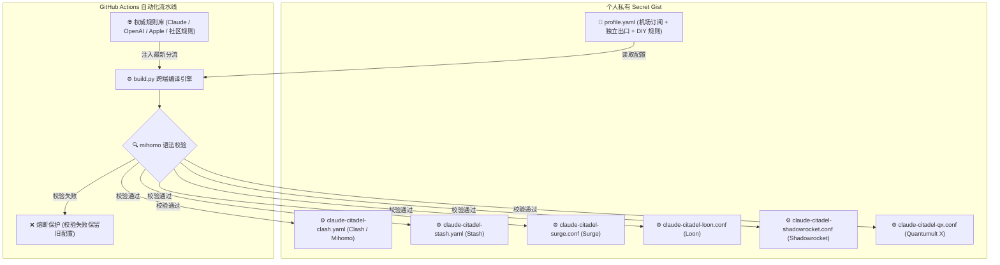

# Claude Citadel

> 🚀 **全平台全协议多机场与 Claude 独立出口自动化同步系统**
>
> 节点与规则深度解耦：自主管理 1~4 家机场、Claude 独立出口与 DIY 专属通道，全自动继承权威上游规则，一键编译并发布至私有 Secret Gist，全平台免密秒级消费。

---

## ✨ 核心特性

- **6 大主流客户端全适配**：
  - **Clash / Mihomo** (`claude-citadel-clash.yaml`) - 桌面端与 Android 标配，支持 Meta 增强特性与 MRS 格式
  - **Stash** (`claude-citadel-stash.yaml`) - iOS / macOS 平台规则优化版，双重兼容 header 格式
  - **Surge** (`claude-citadel-surge.conf`) - iOS / macOS 专业级规则、`underlying-proxy` 链式代理与 `policy-path`
  - **Loon** (`claude-citadel-loon.conf`) - iOS 现代轻量级代理，原生 `[Proxy Chain]` 链式代理
  - **Shadowrocket** (`claude-citadel-shadowrocket.conf`) - iOS 小火箭一键订阅，原生 `chain=中转节点`
  - **Quantumult X** (`claude-citadel-qx.conf`) - iOS 经典神机代理，Filter Remote 与小写规则自动转译
- **Claude 独立出口物理隔离与代理链控制**：
  - Claude / Anthropic 专用节点（原生住宅 IP、自建 VPS、专线）物理隔离于常规中转池，日常流量与测速绝不经过 Claude 节点。
  - 支持 **`use_relay_chain: true / false`** 开关（经由中转链式前置拨号 vs 直接直连拨号）。
- **DIY 自定义策略组与专属通道**：
  - 彻底摆脱固定标签限制，支持自由 DIY 任意策略组（如 `🏢 公司专网`、`🕸️ 私有组网`、`🎮 游戏专线`）。
  - DIY 策略组挂载的独立节点**绝不混入机场测速池**；不配置 DIY 时客户端配置完全干净，零多余分组。
- **项目专属规则标识 (`claude-citadel-`)**：
  - 模板层生成的所有规则集与分流提供者均带有 `claude-citadel-` 专属前缀，品牌与路由归属清晰明确。
- **单 Gist 双向闭环**：
  - 输入（`profile.yaml`）与 6 端输出汇聚在同一个 GitHub Secret Gist。手机网页即可调整节点与规则。
- **离线内核校验与熔断保护**：
  - 集成 `mihomo -t` 内核离线语法检验。格式写错时自动熔断并保留旧配置，绝不污染云端 Gist，网络绝不断网。

---

## 🏗️ 架构拓扑



---

## 一、整个配置怎么配

系统的一切配置均收敛在单一配置文件 **`profile.yaml`** 中（位于你的私有 GitHub Secret Gist）。结构分为四大模块：

### 1. Claude 专用出口 (`claude_exits`)
为 Claude 分配专用出口，日常流量绝不流经此处：
```yaml
claude_exits:
  # 代理链开关：
  # - true: 住宅 IP 国内直连受阻时，流量先经过机场中转节点，再由中转节点发往该出口（规避阻断）
  # - false: 直接直连拨号（适合低延迟专线或原生可直连 VPS）
  use_relay_chain: true

  # 手动独立节点 (支持 socks5, http, ss, trojan, vmess 等所有协议)
  custom_proxies:
    - name: "🇺🇸 专属出口 (SOCKS5)"
      type: socks5
      server: 198.51.100.1
      port: 1080
    - name: "🇺🇸 专属出口 (HTTP)"
      type: http
      server: 198.51.100.1
      port: 8080

  # 专属订阅 (若拥有专门解锁 Claude 的专线机场订阅)
  subscriptions: []
```

### 2. 通用中转池 (`relays`)
用于日常网页浏览、OpenAI、Steam、Google、Telegram 等公网流量：
```yaml
relays:
  # 支持接入 1~4 家或更多机场订阅，系统自动聚合
  subscriptions:
    - name: "猫咪云"
      emoji: "🐱"
      url: "https://sub.airport1.com/api/v1/client/subscribe?token=xxx"
    - name: "良心专线"
      emoji: "❤️"
      url: "https://sub.airport2.com/api/v1/client/subscribe?token=yyy"

  # 手动直连中转节点 (如自建香港/日本直连 VPS)
  custom_proxies:
    - name: "🇯🇵 自建日本直连"
      type: ss
      server: 198.51.100.2
      port: 8388
      cipher: aes-256-gcm
      password: "password123"
```

### 3. DIY 自定义策略组与专属通道 (`diy_groups`)
任意自定义业务策略组。挂载的独立节点**不会混入机场测速池**，且绑定的分流规则享有最高优先级：
```yaml
diy_groups:
  # 示例 A：公司专网直连与网段分流
  - name: "🏢 公司专网"
    type: select
    proxies: [] # 走本地 DIRECT 或自建网关
    rules:
      - "IP-CIDR,192.168.10.0/24,no-resolve"
      - "DOMAIN-SUFFIX,company.internal"

  # 示例 B：私有虚拟组网 (EasyTier / Tailscale / WireGuard)
  - name: "🕸️ 私有组网"
    type: select
    proxies:
      - name: "EasyTier SOCKS5"
        type: socks5
        server: 127.0.0.1
        port: 15555
    rules:
      - "IP-CIDR,10.200.0.0/16,no-resolve"
      - "IP-CIDR,10.201.0.0/16,no-resolve"
      - "PROCESS-NAME,easytier-core"
```

### 4. 自定义分流规则扩展 (`custom_rules`)
置顶注入特定业务规则：
```yaml
custom_rules:
  # 直连放行 (Direct)
  direct:
    rules:
      - "DOMAIN-SUFFIX,example.com"
      - "DOMAIN-SUFFIX,nas.local"
      - "PROCESS-NAME,custom-app"

  # 强制走海外中转 (Relay)
  relay:
    rules:
      - "DOMAIN-SUFFIX,custom-blocked-site.com"

  # 强制走 Claude 出口 (Claude Exit)
  claude_exit:
    rules:
      - "DOMAIN-SUFFIX,my-anthropic-mirror.com"
```

---

## 二、效果是怎么样（分流拓扑与实际效果）

配置编译后，各客户端的实际流量走向呈现**确定性分流**：

| 流量类别 | 命中特征 | 路由策略组 | 默认行为与说明 |
| :--- | :--- | :--- | :--- |
| **Claude / Anthropic** | `claude.ai`、`anthropic.com`、桌面 Claude 进程 | `🇺🇸 海外出口` | 严格经由专用出口发出。若开启代理链，先由机场中转跳板连接出口，防止握手封锁。 |
| **OpenAI / ChatGPT** | `openai.com`、`chatgpt.com`、API 域名 | `🤖 OpenAI` | 默认优先走 `🇺🇸 海外出口`，亦可手工切换为日/美/新/港节点或全局中转。 |
| **Google AI** | `gemini.google.com`、`generativelanguage.googleapis.com` | `🚀 Google AI` | 默认优先走 `🇺🇸 海外出口` 或中转池。 |
| **Apple 服务** | Apple 官方规则库、App Store、iCloud | `🍎 Apple` | 默认直连 `DIRECT`，可切 `🇭🇰 香港`、`🇯🇵 日本`、`🇺🇸 美国`、`🇸🇬 新加坡`、`🇹🇼 台湾`。 |
| **Steam 游戏** | Steam 官方规则库、商店、CDN | `🎮 Steam` | 默认直连 `DIRECT`，下载不耗代理流量；可自由切换至日本/香港等低延迟节点。 |
| **Telegram / 邮件** | Telegram 精确 CIDR、常见海外邮箱服务 | `✈️ Telegram` / `📧 邮件收件` | 自动择优中转出口。 |
| **DIY 专属服务** | 公司内网 `192.168.10.0/24`、EasyTier `10.200.0.0/16` | `🏢 公司专网` / `🕸️ 私有组网` | 精确匹配对应独立节点或直连通道，日常公网测速不经过此通道。 |
| **国内直连白名单** | 常见国内网站、Oracle Cloud、国内主流 AI (Kimi/DeepSeek/通义) | `DIRECT` | 本地高速直连，不绕行海外代理。 |
| **通用海外网站** | GFWList、国外媒体、未列入特定规则的海外请求 | `🌐 海外服务` | 经由 `🔀 中转节点` 自动择优。 |

---

## 三、怎么拿这个链接（订阅生成与获取）

配置和生成后的 6 大客户端配置文件全部存放在你的 **GitHub Secret Gist** 中。

### 第一步：创建你的私有配置 Gist
1. 打开 [GitHub Gist](https://gist.github.com/)，点击新建。
2. 页面右下角确保选择 **Create secret gist**（创建私有 Gist，防止凭据外泄）。
3. 文件名输入 `profile.yaml`，内容参考上方说明填写。
4. 创建后，记录浏览器地址栏中 URL 最后一串 32 位的哈希字符串，此即你的 **`GIST_ID`**。

### 第二步：在仓库中配置自动编译密钥
1. 访问你的 GitHub 仓库（若使用模板创建，请确保选择 **Private** 私有仓库）。
2. 进入 **Settings** -> **Secrets and variables** -> **Actions**。
3. 添加两个密钥：
   - `GIST_ID`：第一步获取的 Gist ID。
   - `GIST_PAT`：具有 `gist` 读写权限的 [GitHub Personal Access Token](https://github.com/settings/tokens)。

### 第三步：触发编译与获取 Raw 链接
1. 进入仓库的 **Actions** 页面，选择 **自动构建与同步订阅** -> 点击 **Run workflow**。
2. 编译成功后，刷新你的 Gist 页面，会看到仓库自动回写了全套 6 大客户端配置文件：
   - `claude-citadel-clash.yaml`
   - `claude-citadel-stash.yaml`
   - `claude-citadel-surge.conf`
   - `claude-citadel-loon.conf`
   - `claude-citadel-shadowrocket.conf`
   - `claude-citadel-qx.conf`
3. 点击对应文件右上角的 **Raw** 按钮，浏览器地址栏中的链接即为最终订阅链接，格式为：
   ```text
   https://gist.githubusercontent.com/<你的用户名>/<你的GIST_ID>/raw/claude-citadel-<客户端文件名>
   ```

---

## 四、最终用户怎么去使用（6 大客户端导入步骤）

获得上述 Raw 链接后，直接在对应客户端导入即可：

### 1. Clash / Mihomo (Clash Verge / Mihomo Party / Flclash)
1. 复制 `.../raw/claude-citadel-clash.yaml`。
2. 打开客户端 -> 进入 **订阅/配置 (Profiles)** -> 粘贴链接并点击 **导入/下载**。
3. 规则模式选择 **Rule (规则模式)**。

### 2. Stash (iOS / macOS)
1. 复制 `.../raw/claude-citadel-stash.yaml`。
2. 打开 Stash -> 进入 **配置列表** -> 点击 **从 URL 下载** -> 粘贴链接并下载。
3. 勾选使用该配置。

### 3. Surge (iOS / macOS)
1. 复制 `.../raw/claude-citadel-surge.conf`。
2. 打开 Surge -> 进入 **配置 (Profiles)** -> 选择 **从 URL 安装配置 (Install Profile from URL)**。
3. 粘贴链接并确认生效。

### 4. Loon (iOS)
1. 复制 `.../raw/claude-citadel-loon.conf`。
2. 打开 Loon -> 进入 **配置 (Configuration)** -> 点击右上角新建/下载远程配置。
3. 粘贴链接更新并加载配置。

### 5. Shadowrocket 小火箭 (iOS)
1. 复制 `.../raw/claude-citadel-shadowrocket.conf`。
2. 打开小火箭 -> 点击右上角 `+` -> 类型选择 **Subscribe (订阅)**。
3. 粘贴链接，保存后点击更新节点与分流。

### 6. Quantumult X (iOS)
1. 复制 `.../raw/claude-citadel-qx.conf`。
2. 打开 Quantumult X -> 进入右下角风车设置 -> 选择 **下载配置文件**。
3. 粘贴链接覆盖加载。

---

## 🤖 零本地环境：使用仓库专属 Skill 自动化配置云端 Action

> [!TIP]
> **绝大多数用户完全不需要克隆仓库到本地，也不需要安装 Python 或任何运行环境。**
> 直接在你的 AI Agent（Claude Code、Antigravity、Codex 等）中加载本项目自带的 **`claude-citadel`** Skill，即可全自动完成云端配置与定时更新维护！

本仓库已内置开箱即用的专属 Skill：[`skills/claude-citadel/SKILL.md`](file:///Users/weicoz/File/git/claude-citadel/skills/claude-citadel/SKILL.md)（同时软链至 `.agents/skills/claude-citadel` 与 `.claude/skills/claude-citadel`）。

### Skill 自动化引导涵盖：
1. **GitHub 权限引导**：指导生成仅含 `gist` 权限的 Personal Access Token 并配置为仓库 Secret（`GIST_PAT` 与 `GIST_ID`）。
2. **`profile.yaml` 辅助生成**：协助用户梳理机场订阅、Claude 专用节点、代理链开关与 DIY 自定义策略组。
3. **触发云端 Actions 编译**：调用 GitHub Actions 自动拉取上游规则、编译 6 大客户端配置并通过 `mihomo -t` 内核语法校验。
4. **回传 6 端订阅链接**：自动获取带 `claude-citadel-` 前缀的 6 端 Raw 链接并提供对应客户端一键导入指引。
5. **托管全自动定时更新**：解释每日定时轮询机制，以及后续用户在网页端修改 `profile.yaml` 后的静默热更新流程。

---

## 🛠️ 可选：本地开发与离线校验

如果你是开发者或希望在本地调试规则，可以使用以下命令：

```sh
# 1. 运行本地回归测试套件 (包含 6 项结构与内核离线校验)
python3 -m unittest discover -s tests -v

# 2. 本地渲染并输出到 output/
python3 build.py --profile profile.example.yaml
```
